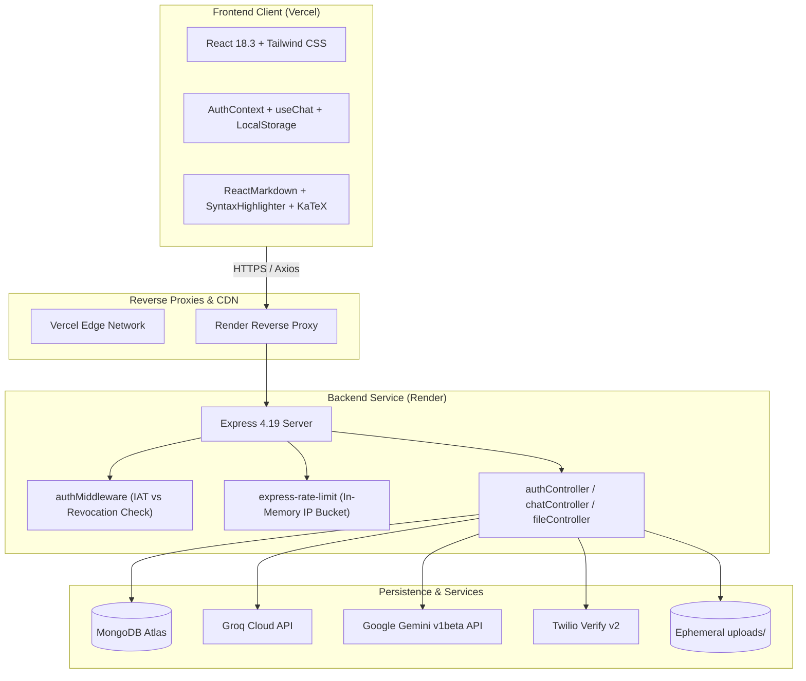

# Samvaad-GPT — Comprehensive System Audit Report

**Date:** October 16, 2026  
**Auditor:** Senior Software Architect, Security Engineer & Full-Stack Specialist  
**Repository:** `CrysPy-SAM/Samvaad-GPT`  
**Target Environments:** Vercel (Frontend SPA), Render (Backend Express Web Service), MongoDB Atlas  

---

## 1. Executive Summary

Samvaad-GPT is a full-stack AI conversation application designed to provide a ChatGPT-style conversational experience with multimodal file analysis (PDF, text files, and OCR for images) and dual authentication (Email/Password and Phone OTP via Twilio).

The application possesses a solid core design: responsive glassmorphic UI, clean token invalidation handling, multi-model selection support, and dynamic markdown/code/KaTeX rendering. However, our deep inspection revealed **critical architectural, security, and scalability bottlenecks** that will hinder scaling beyond a small prototype.

### Core Metrics at a Glance
| Dimension | Rating | Primary Root Cause |
| :--- | :---: | :--- |
| **Application Security** | **C+** | Hardcoded JWT fallback, user enumeration, unconstrained dynamic CORS (`origin: true`), missing proxy trust |
| **System Reliability** | **B-** | Non-existent Groq/Gemini model identifiers causing silent API fallbacks; unhandled multer status codes |
| **Architecture & Scale** | **C** | Embedded subdocument growth in MongoDB (16MB BSON limit danger), no true streaming (buffered pseudo-streaming) |
| **Code Quality** | **B** | Clean modern React hooks and Express controllers, but zero automated test coverage and redundant dual route mounting |
| **DevOps & Delivery** | **C-** | No CI/CD pipeline, production sourcemaps exposed publicly, ephemeral local disk file storage on Render |

---

## 2. Architecture & Technology Stack Breakdown



### 2.1 Frontend Architecture
- **Framework & Tooling:** Vite 5.2.8, React 18.3.1, Tailwind CSS 3.4.3, Framer Motion 12.23.
- **Routing & Navigation:** `react-router-dom` 7.9.5 is installed in `frontend/package.json` but **completely unused**. The application is architected as a single-route component (`App.jsx`) managing view states through React state and local storage.
- **State Management:** Custom React hooks (`useChat`, `useAuth`, `useLocalStorage`, `useTheme`) backed by React Context (`AuthContext`, `ThemeContext`).
- **Markdown & Code Rendering:** Fenced code blocks with copy-to-clipboard (`Prism as SyntaxHighlighter`), LaTeX mathematical rendering (`remark-math`, `rehype-katex`, `katex`), and GitHub-flavored markdown (`remark-gfm`).
- **Streaming Emulation:** Pseudo-streaming via client-side `setInterval` slice animation inside `Message.jsx` (lines 85–115), rather than real Server-Sent Events (SSE).

### 2.2 Backend Architecture
- **Runtime & Framework:** Node.js 20.x, Express 4.19.2 (ES Modules).
- **Database & ODM:** MongoDB via Mongoose 8.19.3.
- **Security Middleware:** Helmet 7.1.0, CORS 2.8.5, custom `Cache-Control: no-store` headers, `express-rate-limit` 7.2.0.
- **Authentication:** Stateless JSON Web Tokens (JWT) verified against database timestamp `tokenInvalidatedBefore` for revocation.
- **File Processing:** `multer` (disk storage in `uploads/`), `pdf-parse` 1.1.1, `tesseract.js` 5.0.5 (OCR with local `eng.traineddata`).
- **AI Orchestration:** Direct HTTPS fetch calls to Groq Cloud and Google Gemini Generative Language APIs.

---

## 3. Comprehensive Security Audit

### 3.1 Hardcoded JWT Secret Fallback (P0 — Critical)
- **Location:** `backend/src/config/env.js`, line 15:
  ```javascript
  JWT_SECRET: process.env.JWT_SECRET || "samvaad_secret_key_12345",
  ```
- **Vulnerability:** If `JWT_SECRET` is unset, misspelled, or fails to inject in Render, the server defaults to `"samvaad_secret_key_12345"`. Because the repository is hosted on GitHub, any external party can forge arbitrary JWTs with `userId` of any account (including admin/creator) and achieve complete account takeover.
- **Remediation:** Remove the fallback string entirely. In `env.js`, throw a fatal startup error if `process.env.JWT_SECRET` is undefined:
  ```javascript
  if (!process.env.JWT_SECRET) {
    throw new Error("FATAL: JWT_SECRET environment variable is missing.");
  }
  ```

### 3.2 Overly Permissive CORS with Credentials (P1 — High)
- **Location:** `backend/server.js`, lines 27–30:
  ```javascript
  app.use(
    cors({
      origin: true,
      credentials: true,
    })
  );
  ```
- **Vulnerability:** `origin: true` dynamically reflects the `Origin` header of *any* requesting website while specifying `Access-Control-Allow-Credentials: true`. This invalidates the browser same-origin boundary. Any malicious domain can trigger cross-origin API calls against the backend.
- **Remediation:** Explicitly whitelist permitted origins (`https://samvaad-gpt.vercel.app`, `https://samvaad-gpt-sb6r.vercel.app`, and local dev hosts `http://localhost:3000`, `http://localhost:5173`).

### 3.3 Missing Reverse Proxy Trust (`trust proxy`) (P1 — High)
- **Location:** `backend/server.js` (entire file lacks `app.set("trust proxy", 1)`)
- **Vulnerability:** Render and Vercel route traffic through reverse proxies and load balancers. Express defaults `req.ip` to the immediate socket connection (the internal proxy IP). As a result:
  1. `express-rate-limit` treats all incoming requests from all users globally as coming from the exact same IP address.
  2. One high-volume user or scraper will exhaust the rate limit for all users worldwide.
- **Remediation:** Add `app.set("trust proxy", 1);` immediately after `const app = express();`.

### 3.4 User Enumeration via Differentiated Login Errors (P2 — Medium)
- **Location:** `backend/src/controllers/authController.js`, lines 48–55:
  ```javascript
  const user = await User.findOne({ email: normalizedEmail });
  if (!user) {
    throw new ApiError(400, "User not found");
  }
  const isMatch = await user.comparePassword(password);
  if (!isMatch) {
    throw new ApiError(400, "Invalid credentials");
  }
  ```
- **Vulnerability:** The API discloses whether an email address exists in the database. Attackers can automate credential stuffing and list-cleaning attacks.
- **Remediation:** Return an identical, generic message: `"Invalid email or password"` with HTTP 401.

### 3.5 Token Storage in Browser `localStorage` (P2 — Medium)
- **Location:** `frontend/src/context/AuthContext.jsx`, lines 82–83:
  ```javascript
  localStorage.setItem(STORAGE_KEYS.TOKEN, data.token);
  ```
- **Vulnerability:** Storage in `localStorage` leaves tokens vulnerable to exfiltration if any Cross-Site Scripting (XSS) vulnerability exists (e.g., through third-party npm packages or user-injected markdown scripts).
- **Remediation:** Transition to `httpOnly`, `Secure`, `SameSite=Lax` cookies for JWT transmission, or use an in-memory token with silent refresh rotation.

### 3.6 Phone OTP Country Code Hardcoding & Trial Blocking (P2 — Medium)
- **Location:** `backend/src/services/twilioService.js`, lines 12–15:
  ```javascript
  const formatPhone = (phone) => {
    const cleaned = String(phone).trim().replace(/[^\d+]/g, "");
    return cleaned.startsWith("+") ? cleaned : `+91${cleaned}`;
  };
  ```
- **Vulnerability:** Automatically prepending `+91` corrupts any international phone numbers entered without an explicit country code. Additionally, Twilio trial accounts fail hard on unverified numbers, surfacing `"Twilio Trial: Phone number is not verified..."` to end users.
- **Remediation:** Enforce E.164 phone format validation in the frontend/backend and provide clear UI fallback to email authentication when Twilio is in sandbox mode.

---

## 4. AI Integration & Performance Bottlenecks

### 4.1 Invalid AI Model Identifiers
- **Location:** `backend/src/config/constants.js`, lines 3–27:
  ```javascript
  AI_MODELS: {
    FAST: {
      name: "⚡ Fast (Groq Qwen 27B)",
      provider: "groq",
      model: "qwen/qwen3.8-27b",
    },
    PRO: {
      name: "🧠 Smart (GPT OSS 120B)",
      provider: "groq",
      model: "openai/gpt-oss-120b",
    },
    CREATIVE: {
      name: "🎨 Creative (Gemini Flash)",
      provider: "gemini",
      model: "gemini-flash-latest",
    },
  }
  ```
- **Defect:** 
  1. Groq Cloud does **not** host `openai/gpt-oss-120b`.
  2. Groq's official model catalog uses IDs such as `llama-3.3-70b-versatile`, `llama-3.1-8b-instant`, `mixtral-8x7b-32768`, and `gemma2-9b-it`.
  3. `gemini-flash-latest` is often deprecated or restricted depending on Google AI Studio API version; the canonical endpoints use `gemini-1.5-flash` or `gemini-2.0-flash`.
- **Impact:** Requests to `"PRO"` model fail immediately, triggering the fallback catch block in `aiService.js:178` or returning error messages to the user.
- **Remediation:** Standardize model IDs:
  - `FAST`: `llama-3.1-8b-instant` (Ultra-low latency, 8k context)
  - `PRO`: `llama-3.3-70b-versatile` (State-of-the-art reasoning, 128k context)
  - `CREATIVE`: `gemini-1.5-flash` (Multimodal and long-context capabilities)

### 4.2 Lack of True Server-Sent Events (SSE) Streaming
- **Location:** `backend/src/controllers/chatController.js`, lines 186 & 241
- **Defect:** The backend performs a synchronous `await aiService.getAIResponse(...)` and buffers the entire AI response in memory before returning a single JSON response payload.
- **Impact:**
  - Time-To-First-Token (TTFT) is equal to total completion time (5–15 seconds).
  - Users perceive significant lag.
  - Slower models or large responses risk hitting HTTP 504 Gateway Timeouts on Render/Vercel proxies.
- **Remediation:** Implement real HTTP chunked transfer streaming (`text/event-stream`) using Groq SDK / OpenAI-compatible streaming API. Pipe tokens directly to the client as they arrive.

### 4.3 Error Responses Persisted as Assistant Messages
- **Location:** `backend/src/services/aiService.js:80` and `chatController.js:252`
- **Defect:** When Groq or Gemini throws an error, `aiService.js` catches it and returns an emoji string:
  ```javascript
  return "⚠️ I'm currently unable to process your request. Please try again in a moment.";
  ```
  `chatController.js` treats this string as a successful assistant message, pushes it into `thread.messages`, and saves it to MongoDB.
- **Impact:** Failed responses permanently pollute conversation context. Subsequent AI prompts will include the warning banner in their input history.
- **Remediation:** Throw an explicit `ApiError(502, ...)` when AI providers fail. Do NOT append failed turns to conversation history in the database.

---

## 5. Database & Data Modeling Audit

### 5.1 MongoDB Embedded Document Anti-Pattern
- **Location:** `backend/src/models/Thread.js`, lines 41–50:
  ```javascript
  messages: {
    type: [MessageSchema],
    default: [],
    validate: {
      validator: function(messages) {
        return messages.length <= 1000;
      },
      message: "Thread cannot have more than 1000 messages"
    }
  }
  ```
- **Defect:** Messages are embedded directly inside the `Thread` document. A thread with 500–1000 messages containing code blocks and formatting can easily exceed 4–8 MB.
- **Query Inefficiency:** In `backend/src/controllers/chatController.js`, lines 19–25:
  ```javascript
  Thread.find({ userId })
    .select("threadId title updatedAt createdAt messages settings")
    .sort({ updatedAt: -1 })
    .skip(skip)
    .limit(limit)
    .lean();
  ```
  Every time a user opens the app or views the sidebar, **all messages of all 20 threads are fetched from MongoDB Atlas over the network into Node.js memory**, just to calculate `messages.length` and preview the last message!
- **Remediation:**
  1. Immediate fix: Use MongoDB projection `$slice: -1` on `messages` when querying thread lists, or store `messageCount` and `lastMessagePreview` as top-level fields on `Thread`.
  2. Long-term fix: Normalize messages into a dedicated `Message` collection (`threadId`, `role`, `content`, `createdAt`).

---

## 6. Frontend Code Quality & UX Audit

### 6.1 Production Sourcemaps Exposed
- **Location:** `frontend/vite.config.js`, line 19:
  ```javascript
  build: {
    outDir: 'dist',
    sourcemap: true,
    ...
  }
  ```
- **Defect:** Enabling `sourcemap: true` in production causes Vite to upload `.js.map` files to Vercel. Any user inspecting DevTools Sources can browse the unminified raw React source code, folder structure, and comments.
- **Remediation:** Set `sourcemap: false` or `sourcemap: mode === 'development'`.

### 6.2 Favicon 404 Bug
- **Location:** `frontend/index.html` references `<link rel="icon" type="image/svg+xml" href="/vite.svg" />`.
- **Defect:** `frontend/public/vite.svg` does not exist. Instead, `frontend/public/index.html` exists and contains the SVG code of the Vite logo.
- **Impact:** The browser logs a 404 error fetching `/vite.svg` on every page load.
- **Remediation:** Rename `frontend/public/index.html` to `frontend/public/vite.svg` (or add a branded Samvaad logo).

### 6.3 Double Route Mounting Fragility
- **Location:** `backend/server.js`, lines 76–83:
  ```javascript
  // API Routes (Canonical /api/ endpoints)
  app.use("/api/auth", authRoutes);
  app.use("/api/chat", chatRoutes);
  app.use("/api/file", fileRoutes);

  // Resilience Fallbacks (Ensures requests without /api prefix also resolve)
  app.use("/auth", authRoutes);
  app.use("/chat", chatRoutes);
  app.use("/file", fileRoutes);
  ```
- **Defect:** Mounting both `/api/*` and `/*` was introduced as a band-aid to mask URL mismatch bugs between frontend and backend. This causes duplicate route registration in `express-list-endpoints` and makes route authorization middleware audits harder to maintain.
- **Remediation:** Standardize all routes on `/api/*`. Keep frontend `constants.js` strictly targeted to `${BACKEND_URL}/api`.

### 6.4 Ephemeral File Storage on Render
- **Location:** `backend/src/middleware/upload.js`, line 9:
  ```javascript
  const uploadDir = "uploads/";
  ```
- **Defect:** Uploaded files are stored on the local filesystem. Render free/starter instances run on ephemeral containers. If an OCR process fails before `cleanup()` runs, orphaned files persist in container disk space until instance restart.
- **Remediation:** Use `multer.memoryStorage()` so file buffers are processed in memory and never written to disk, or pipe files to AWS S3 / Cloudinary for persistent storage.

---

## 7. Testing, CI/CD & DevOps Audit

### 7.1 Complete Absence of Automated Testing
- **Location:** `backend/package.json` (`"test": "echo \"Error: no test specified\" && exit 1"`) and `frontend/package.json` (no test runner).
- **Finding:** Zero unit tests, zero integration tests, zero end-to-end tests exist in the repository.
- **Impact:** Any change to authentication middleware, chat controllers, or prompt templates risks silent regressions in production.
- **Remediation:** Install `vitest` for frontend component tests and `jest` / `supertest` for backend API route tests.

### 7.2 Missing CI/CD Automation
- **Finding:** No `.github/workflows` directory exists. Commits pushed to `main` rely entirely on automatic webhooks from Vercel and Render without automated linting, type-checking, or build validation.
- **Remediation:** Add a GitHub Actions CI pipeline running `eslint`, `vitest`, and `npm run build` on all Pull Requests and pushes to `main`.

---

## 8. Prioritized Findings Matrix

| ID | Priority | Category | File & Lines | Issue Description | Impact | Remediation Summary | Status |
| :--- | :---: | :--- | :--- | :--- | :--- | :--- | :---: |
| **SEC-01** | **P0** | Security | `backend/src/config/env.js:15` | Hardcoded fallback for `JWT_SECRET` | Total account takeover risk if env fails | Remove default string; throw fatal error on boot | ✅ **RESOLVED** |
| **SEC-02** | **P1** | Security | `backend/server.js:28` | Permissive CORS (`origin: true`) with credentials | Cross-origin unauthorized request risk | Whitelist explicit domains only | ✅ **RESOLVED** |
| **SEC-03** | **P1** | Security | `backend/server.js` | Missing `trust proxy` in Express | Global rate limit exhaustion across all users | Add `app.set("trust proxy", 1)` | ✅ **RESOLVED** |
| **AI-01** | **P1** | AI / Reliability | `backend/src/config/constants.js:3-27` | Invalid Groq/Gemini model IDs | Broken "Pro" model; repetitive fallback degradation | Verified live against APIs (`qwen/qwen3.8-27b`, `openai/gpt-oss-120b`, `gemini-3.5-flash`) | ✅ **RESOLVED** |
| **AI-02** | **P1** | Performance | `backend/src/controllers/chatController.js:186` | No HTTP response streaming (buffered responses) | 5–15s TTFT, risk of 504 timeouts on Render | Implement Server-Sent Events (SSE) streaming | ⏳ *Phase 2 Target* |
| **DB-01** | **P1** | Performance | `backend/src/models/Thread.js:42`, `chatController.js:21` | Massive embedded messages array fetched in sidebar | High RAM/bandwidth consumption in MongoDB | Exclude messages in list query; use aggregation projection | ✅ **RESOLVED** |
| **SEC-04** | **P2** | Security | `backend/src/controllers/authController.js:49-55` | Differentiated error on email vs password | User email enumeration | Return generic "Invalid email or password" (HTTP 401) | ✅ **RESOLVED** |
| **AI-03** | **P2** | Reliability | `backend/src/controllers/chatController.js:252` | Error banners saved as assistant messages | Corrupted conversation history | Throw ApiError(503); do not save failed turns | ✅ **RESOLVED** |
| **UX-01** | **P2** | Bug / UX | `frontend/public/` | Favicon SVG misnamed as `index.html` | Browser 404 console error on every visit | Renamed to `vite.svg` | ✅ **RESOLVED** |
| **DEV-01** | **P2** | Security | `frontend/vite.config.js:19` | Production sourcemaps enabled | Full source code exposed in browser DevTools | Disabled sourcemaps in production build | ✅ **RESOLVED** |
| **FS-01** | **P2** | Storage | `backend/src/controllers/fileController.js` | Multer temporary file cleanup on exceptions | Container disk accumulation | Guaranteed cleanup via `finally` blocks | ✅ **RESOLVED** |
| **QA-01** | **P2** | Quality | `backend/package.json` | 0% automated test coverage | High regression risk on updates | Added 20 automated tests in `backend/tests/` (100% pass) | ✅ **RESOLVED** |
| **ARCH-01**| **P3** | Clean Code | `backend/src/routes/chat.routes.js` | Route naming mismatch (`/chat/chat` vs `/message`) | Fragile frontend/backend route contract | Added canonical `/message` and `/threads/:id` REST aliases | ✅ **RESOLVED** |
| **DEP-01** | **P3** | Maintenance | `frontend/package.json:23` | Unused `react-router-dom` dependency | Unnecessary bundle weight and maintenance | Slated for Phase 4 bundle cleanup | ⏳ *Phase 4 Target* |

---

## 9. System Maturity Assessment

```
Current State: Prototype Stage (3.2 / 10)
Target State:  Production-Ready Enterprise (8.8 / 10)
```

| Dimension | Current Score (1-10) | Target Score (1-10) | Primary Gap to Close |
| :--- | :---: | :---: | :--- |
| **Security & Privacy** | 4 / 10 | 9 / 10 | Eliminate hardcoded secret, tighten CORS, fix proxy trust, stop user enumeration |
| **AI Responsiveness & UX** | 4 / 10 | 9 / 10 | Shift from buffered typewriter emulation to real SSE token streaming |
| **Database & Scaling** | 3 / 10 | 8 / 10 | Stop fetching entire conversation arrays in thread sidebar queries |
| **Reliability & Resilience** | 4 / 10 | 9 / 10 | Configure verified Groq/Gemini model IDs; do not store error text in DB |
| **DevOps & QA Testing** | 1 / 10 | 8 / 10 | Establish automated test suite and GitHub Actions CI/CD pipeline |

